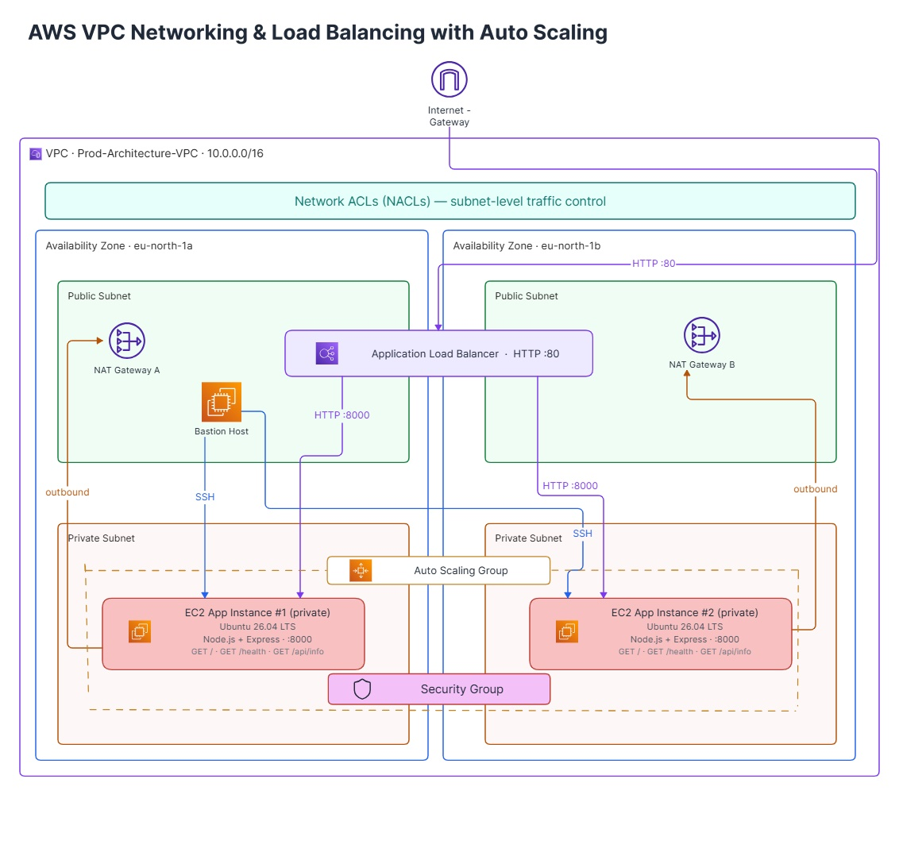

# AWS Production-Style VPC Architecture
A hands-on AWS networking project where I built a production-style VPC with public and private subnets, NAT Gateways, a bastion host, Application Load Balancer, Auto Scaling Group and two EC2 instances running a Node.js/Express application.

The main goal of this project was to understand how AWS networking components work together.

## Architecture
The architecture consists of:

- 1 VPC
- 2 Availability Zones
- 2 Public Subnets
- 2 Private Subnets
- Internet Gateway
- 2 NAT Gateways
- Application Load Balancer
- Auto Scaling Group
- 2 EC2 instances in private subnets
- Bastion Host for SSH access
- Security Groups
- Network ACLs



## Application
A small Node.js/Express application was deployed on the private EC2 instances.

The application runs on port 8000.

## Endpoints
``` 
GET /
GET /health
GET /api/info
```

The /api/info endpoint returns information such as the hostname of the EC2 instance.

This was useful for testing the Load Balancer because requests could reach different EC2 instances.

## Network Architecture

### Public Subnets
The public subnets contain resources that need direct connectivity to the Internet.

They are associated with a route table containing a route to the Internet Gateway.

The following resources were placed in the public subnets:
- Application Load Balancer
- Bastion Host
- NAT Gateways

### Private Subnets
The application EC2 instances were placed in private subnets.

The private instances do not have direct Internet access through an Internet Gateway.

For outbound Internet connectivity, the private subnets route traffic through NAT Gateways located in the public subnets.

## Availability Zones
The VPC uses two Availability Zones.

Each Availability Zone contains:
- One public subnet
- One private subnet
- The application instances run across both Availability Zones.

This provides better availability than placing all application instances in a single Availability Zone.

## Bastion Host
A Bastion Host was used as the SSH entry point to the private EC2 instances.

The connection flow was:

```
My Computer
     |
     | SSH
     v
Bastion Host
     |
     | SSH
     v
Private EC2 Instance
```

## Load Balancer
An Application Load Balancer was configured to receive HTTP requests and forward them to the Node.js applications running on port 8000.

The target group contained two EC2 instances.

The /api/info endpoint was also used to verify that requests could reach different instances.

Example responses showed different hostnames:
```
{
  "hostname": "ip-10-0-157-19",
  "platform": "linux",
  "architecture": "x64",
  "nodeVersion": "v22.2.1"
}

{
  "hostname": "ip-10-0-137-44",
  "platform": "linux",
  "architecture": "x64",
  "nodeVersion": "v22.2.1"
}
```

## Technologies / AWS Services
- AWS VPC
- EC2
- Application Load Balancer
- Auto Scaling Group
- NAT Gateway
- Internet Gateway
- Security Groups
- Network ACLs
- Route Tables
- Node.js
- Express.js

## Project Status
The AWS resources were terminated after completing the project to avoid unnecessary ongoing costs.
